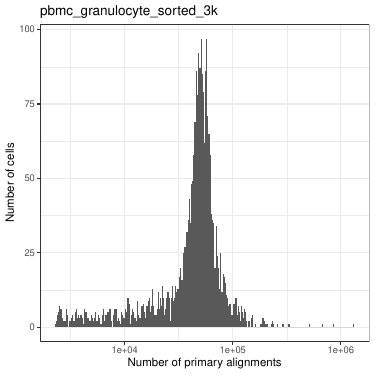
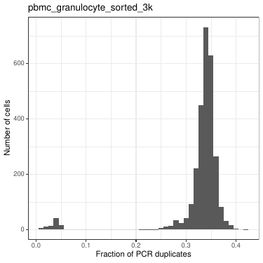
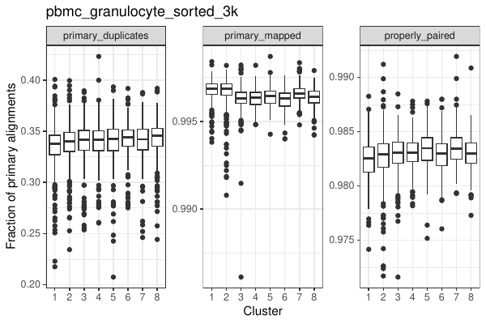
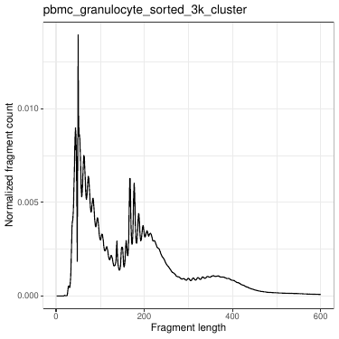
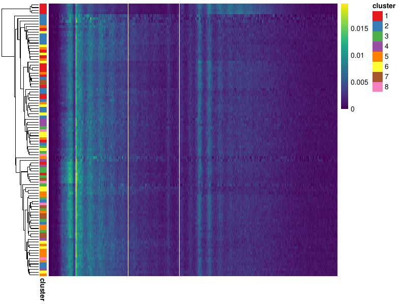
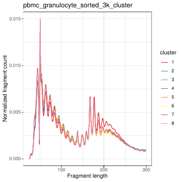
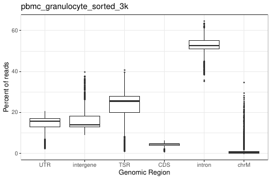
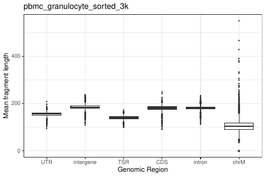
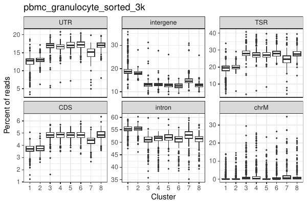
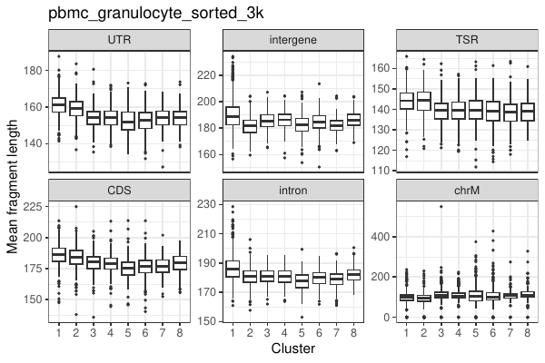

# Quality control of single-cell ATAC-seq datasets
We can compute several per-cell quality control (QC) metrics from the
BAM file and the barcode counts generated in the [10x ATAC-seq
analysis](10x_atac_seq.md). These metrics give an overview of
the sequencing experiment and the data quality, and these metrics could
also be used to filter out low-quality cells prior to any downstream
analysis.

All the QC metrics below are computed for each cell, and they can be
visualized across all cells in a sample as a first step prior to any
analysis. Though, these metrics could also be useful after the user has
clustered and/or annotated the data where the metrics can be stratified by
the cluster ID and are useful for comparing differences between clusters.

The commands below use the `{sample}_bc_match.bam` file from the 10x
multiome protocol; for the 10x scATAC-seq protocol, use
`{sample}_markdup.bam` instead. The helper scripts used for the plots are
in the `scripts` directory.

## Alignment statistics
`samtools flagstat` is extremely useful to get alignment statistics
such as the number of aligned reads, number of PCR duplicates, etc. from
a sam/bam file. `bc_flagstat` gives almost the same information as
`flagstat` at a single cell level:

```
bc_flagstat -a {sample}_bc_match.bam -b {sample}_bc_counts.txt -o {sample}
```

The helper scripts can then be used to generate the plots:
```
atacFlagstat.R -f {sample}_bc_flagstat.txt -c {cluster_id.tsv} -o {sample}
```

Where `-c {cluster_id.tsv}` is an optional parameter with the cluster
identity for each cell: a 2-column TSV file without a header that
contains the cell barcode in the first column and the cluster ID in the
second column. If this file is provided, additional plots with cells
split by clusters are generated.

The number of alignments per cell:



The fraction of PCR duplicates per cell:



When the cluster ID is provided, these are also plotted per cluster:



## Fragment length distribution
ATAC-seq data generates the characteristic fragment length distribution
that contains peaks corresponding to nucleosome-free, mono-nucleosome,
and multi-nucleosome bound fragments. We can similarly visualize the
fragment length distribution at a single-cell level:
```
bc_frag_dist -a {sample}_bc_match.bam -b {sample}_bc_counts.txt \
  -q 30 -o {sample}
```

We can then use the helper scripts for visualization:
```
atacFragLength.R -f {sample}_bc_frag_len.txt -s {sample}_sample_frag_len.txt \
  -c {cluster_id.tsv} -o {sample}
```

The bulk fragment length distribution across all cells:



The fragment length distributions are plotted for each cell. The x-axis
is the fragment length, and ranges from 25bp at the left end to 300bp at
the right end (this range can be changed with the `-m` and `-M` options
of `atacFragLength.R`); the axis labels are not shown for clarity. When
the cluster ID is provided, it annotates the heatmap with the ID.



Also, when the cluster ID is provided, the pseudo-bulked fragment
lengths for all cells in a cluster are also plotted:




## Aligned genomic regions
In an ATAC-seq experiment, we would expect a lot of reads to align to
the open chromatin regions that are mostly located in TSS and gene body
regions. `bc_atac_genomic_features` is used to determine the fraction of
reads aligned to different genomic regions at the single cell level:

```
bc_atac_genomic_features -a {sample}_bc_match.bam -b {sample}_bc_counts.txt \
  -g annotation.gtf -q 30 -o {sample} [-r tss_m1k.bed]
```

We can then use the helper scripts for visualization:

```
atacGenomicRegionStats.R -f {sample}_feature_counts.txt \
  -l {sample}_feature_frag_len.txt -c {cluster_id.tsv} -o {sample}
```

The fraction of reads aligned to distinct genomic regions for each cell:



The mean fragment lengths of the fragments aligned to these regions:



When the cluster ID is provided, these plots are also stratified by
clusters.




